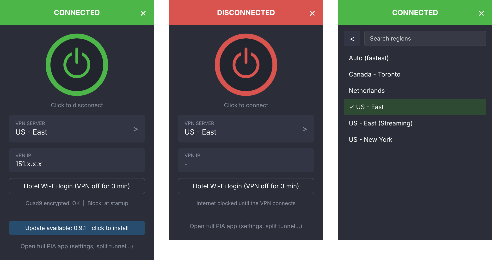
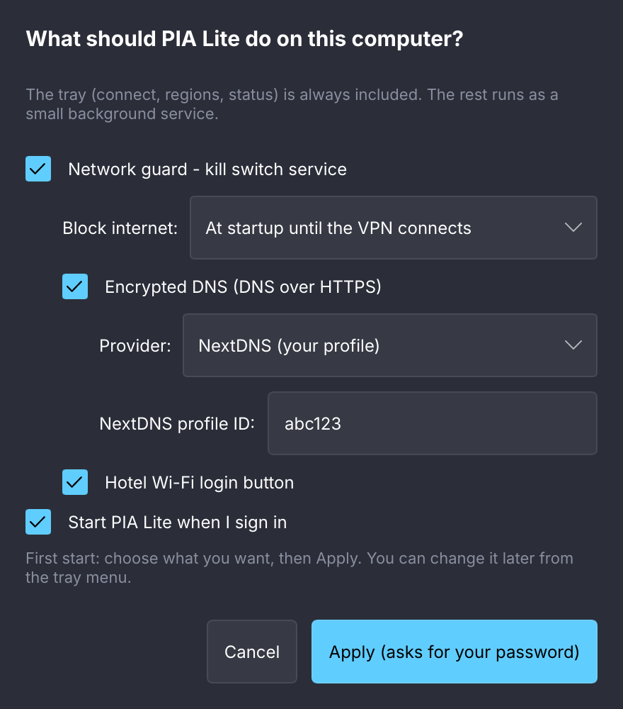
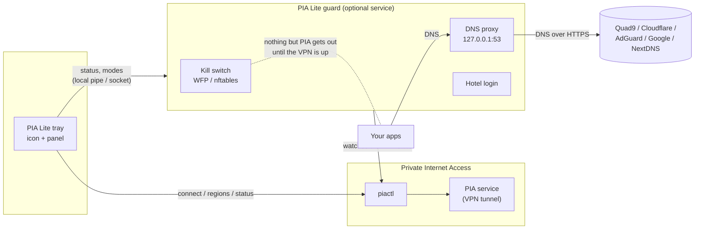

<p align="center">
  
</p>

<p align="center">
  <a href="https://github.com/NicholasBly/PIALite/actions/workflows/ci.yml"></a>
  <a href="https://github.com/NicholasBly/PIALite/releases/latest"></a>
  
  <a href="LICENSE"></a>
</p>

**PIA Lite** is a small, fast tray app for [Private Internet Access](https://www.privateinternetaccess.com/) (PIA).
It replaces PIA's own window with a tray icon and a compact panel - connect, disconnect, pick a region, see your
status - and talks to PIA only through PIA's official command-line tool (`piactl`). PIA's VPN service, drivers,
kill switch and split tunnel keep working exactly as before.

On top of that you can **choose** extras when you install - nothing is forced on you:

| Feature | What it does |
|---|---|
| **Network guard** (kill switch) | A tiny background service that blocks the internet until the VPN is connected - from power-on, or always. Works next to PIA's own kill switch as a second, independent layer. |
| **Encrypted DNS** | Every DNS lookup goes over HTTPS to the provider *you* pick: Quad9, Cloudflare, AdGuard, Google, NextDNS (your own profile) or any DNS-over-HTTPS server. |
| **Hotel Wi-Fi login** | One click turns the VPN off for a few minutes so you can get past a hotel/airport login page, then everything comes back by itself. |
| **Updates** | The tray checks GitHub about once a day, or when you click *Check for updates* in its menu; one click installs a new release - only if its signature checks out - and keeps your features. |

**Lighter than what it replaces:** on a Windows 11 PC that ran PIA's window and the NextDNS app, switching to PIA
Lite took the memory those programs reserve from **187 MB to 22 MB**, and one small service now does the jobs of
several programs - see [How much lighter?](#how-much-lighter)

> PIA Lite is an independent open-source project. It is **not affiliated with, endorsed by or supported by
> Private Internet Access**. You need a PIA subscription and PIA's own app installed.

<p align="center">
  
</p>

---

## Contents

- [How much lighter?](#how-much-lighter)
- [Download and install](#download-and-install)
- [Choosing features](#choosing-features)
- [Encrypted DNS providers](#encrypted-dns-providers)
- [Kill switch modes](#kill-switch-modes)
- [How it works](#how-it-works)
- [Updates](#updates)
- [Stuck offline?](#stuck-offline)
- [Uninstall](#uninstall)
- [Command line](#command-line)
- [Troubleshooting](#troubleshooting)
- [Building from source](#building-from-source)
- [Security](#security) - [Contributing](#contributing) - [License](#license)

## How much lighter?

Measured on one Windows 11 PC with PIA 3.6 in November 2026 - first with PIA's own window and the NextDNS app, then
with PIA Lite.
The numbers are **private memory**: what Windows reserves for that program alone (Task Manager > *Details* >
right-click a column header > *Select columns* > **Commit size**).

| Job | Before | Private memory | After (PIA Lite) | Private memory |
|---|---|---|---|---|
| Tray icon, connect, regions | PIA's window, hidden in the tray (`pia-client`) | 163 MB | `pialite-tray` | 2.4 MB |
| Watching the VPN's state | (inside PIA's window) | - | 2 x PIA's own `piactl monitor` (one for the tray, one for the guard) | 17.5 MB |
| Encrypted DNS | NextDNS app (`NextDNSService`) | 24 MB | `pialite-guard` - also the kill switch, the DNS leak block and hotel login | 2.2 MB |
| **Total** | | **187 MB** | | **22 MB** |

PIA's VPN services (`pia-service`, `pia-wgservice`) run either way and aren't counted. Your numbers will differ a
little with your PIA version and what you turn on.

- **Why Task Manager's default "Memory" column can show less:** Windows moves memory a hidden window isn't using
  out of RAM - at that moment only about 34 MB of PIA's window was actually in RAM. Commit size is everything the
  program still holds (in RAM or the page file), and it comes back into RAM as soon as the window is used.
- **CPU:** don't expect a faster PC - idle CPU was close to zero before and after (PIA's hidden window averaged
  0.03 %), and the tray and guard each showed 0.1 s of CPU time or less in the same measurement. PIA Lite keeps it
  that way by doing little: the panel is drawn only while it is open, on the CPU (no web engine, no GPU process);
  the connection is watched by `piactl monitor` instead of polling; the tray asks the guard for its status every
  4 seconds and PIA for the region and IP once a minute or when something changes.
- **Fewer programs at sign-in:** PIA's window no longer starts (PIA's VPN service keeps the VPN up), and there is
  no separate DNS app.

**One program instead of several:**

| Instead of | PIA Lite has |
|---|---|
| PIA's window for everyday use | the tray icon and panel. PIA's full app is still installed for settings and split tunnel - *Open full PIA app* in the tray menu. |
| The NextDNS app (or YogaDNS, or another DNS client) | encrypted DNS in the guard, with your **NextDNS profile** or any of the other providers. The Windows installer pauses the NextDNS service so the two don't fight; you can uninstall the NextDNS app afterwards. |
| A DNS client's "block plain DNS" option | while the VPN is connected, DNS to any other server is blocked - plain DNS (port 53) and DNS over TLS (853). |
| Turning the kill switch off by hand for a hotel login page | *Hotel Wi-Fi login*: VPN off for a few minutes, then everything comes back by itself. |
| Watching the release page | *Check for updates* in the tray menu, or the daily check; signed updates install with one click. |

## Download and install

Get the files from the **[latest release](https://github.com/NicholasBly/PIALite/releases/latest)**.
Install [PIA](https://www.privateinternetaccess.com/download) first and sign in to it once.

| System | File | How |
|---|---|---|
| Windows 10/11 (64-bit) | `PIALite-<version>-windows-x64.msi` | Double-click. The installer lets you pick features and your DNS provider. |
| Windows, no install | `PIALite-<version>-windows-x64-portable.zip` | Unzip anywhere, run `pialite-tray.exe`. Tray only (no guard). |
| Debian, Ubuntu, Mint, Pop!_OS | `pialite_<version>_amd64.deb` | `sudo apt install ./pialite_<version>_amd64.deb` |
| Fedora, RHEL, openSUSE | `pialite-<version>-1.x86_64.rpm` | `sudo dnf install ./pialite-<version>-1.x86_64.rpm` |
| Any Linux with systemd | `PIALite-<version>-linux-x86_64.tar.gz` | Unpack, then `sudo ./install.sh` - or run `bin/pialite-tray` as is (tray only). |

On Linux the packages only copy files. The **first time you open PIA Lite** (from your applications menu) it asks
which features you want - or run `sudo pialite-guard setup -i` in a terminal.

<details>
<summary><b>Silent / scripted install on Windows</b></summary>

```bat
msiexec /i PIALite-0.9.0-windows-x64.msi /qn DNS_PROVIDER=quad9 BLOCK_MODE=startup
msiexec /i PIALite-0.9.0-windows-x64.msi /qn ADDLOCAL=Main,Guard,Dns DNS_PROVIDER=nextdns NEXTDNS_ID=abc123
```

| Property | Values |
|---|---|
| `DNS_PROVIDER` | `quad9` (default), `cloudflare`, `adguard`, `google`, `nextdns` |
| `NEXTDNS_ID` | your NextDNS profile ID, with `DNS_PROVIDER=nextdns` |
| `BLOCK_MODE` | `startup` (default), `always`, `off` |
| Features (`ADDLOCAL` / `REMOVE`) | `Main` (always), `Guard`, `Dns`, `Hotel`, `Autostart`, `HidePia` |

</details>

<details>
<summary><b>Coming from a pre-0.9 build (PowerShell installer)?</b></summary>

Just install the MSI. It takes over the existing guard service and its settings (NextDNS profile, block mode),
and the new tray removes the old copy from your profile and its startup entry the first time it starts.

</details>

## Choosing features



- **Windows:** the installer shows a feature tree, then a page for the DNS provider and the kill switch mode.
  To change your choice later: *Settings > Apps > PIA Lite > Modify* - or *Features and DNS provider...* in the
  tray menu, which opens the same screens.
- **Linux:** the features window (right) opens the first time you start PIA Lite, and from the tray menu
  any time later. It asks for your password (polkit) to apply. In a terminal: `sudo pialite-guard setup -i`.

Whatever you pick is written to an install record, so **updates install the same features** again.

| Option | Needs | Default |
|---|---|---|
| Network guard (kill switch) | - | on, mode *startup* |
| Encrypted DNS | guard | on, Quad9 |
| Hotel Wi-Fi login | guard | on |
| Start at sign-in | - | on |
| Don't start PIA's own window (Windows) | - | on - saves about 160 MB; PIA's VPN service still runs |

<br clear="right">

## Encrypted DNS providers

| Provider | Choose it for | Server |
|---|---|---|
| **Quad9** | privacy-focused non-profit, blocks known malware domains | `dns.quad9.net` (DNS over TLS - Quad9 ended DNS over HTTPS/1.1 in Dec 2025) |
| **Cloudflare** | speed | `cloudflare-dns.com` |
| **AdGuard** | blocks ads and trackers | `dns.adguard-dns.com` |
| **Google** | Google Public DNS | `dns.google` |
| **NextDNS** | your own filter lists, logs and parental controls (needs a free/paid NextDNS profile ID) | `dns.nextdns.io/<your id>` |
| **Custom** | your own server - e.g. a **Pi-hole at home** ([guide](docs/PIHOLE.md)) - over HTTPS or TLS, with its own certificate authority if it has one | `set-dns custom tls://pi.hole IP [CA-FILE]` |

The guard connects to the provider by IP address (no plain-DNS lookup ever happens to find it) and checks its TLS
certificate. Lookups go over HTTPS (DoH), or over TLS on port 853 (DoT) for Quad9. Switch any time: `pialite-guard set-dns cloudflare` (admin), or the features window.

- **Windows:** PIA's DNS setting is pointed at the guard (`127.0.0.1`); your previous setting is saved and put back
  on uninstall. If the NextDNS Windows app is installed, it is paused (not removed) so two DNS programs don't fight.
  While the VPN is connected, **DNS to any other server is blocked** (plain DNS on port 53 and DNS over TLS on 853):
  a program that asks 8.8.8.8 itself gets no answer, and neither do VMs that share this PC's connection. PIA's own
  programs and the guard are let through. (PIA applies its DNS setting when it connects - after installing while
  connected, reconnect PIA once; `pialite-guard status` shows "Other DNS : blocked" when it is on.)
- **Linux:** the guard redirects every program's plain DNS (port 53) to itself with an nftables rule - whatever
  your distribution uses for DNS (systemd-resolved, NetworkManager, resolv.conf). PIA's own lookups are left alone.
- **Conflicts are reported, not hidden.** Setup (and `pialite-guard adapter-dns`) checks for things that would let
  lookups skip PIA Lite: DNS typed in by hand on a Windows network adapter (for example NextDNS with Windows' own
  "DNS over HTTPS" ticked - Windows may ask those servers too), other DNS programs (YogaDNS, dnscrypt-proxy,
  AdGuard...), and anything else holding port 53. `pialite-guard adapter-dns --reset` sets typed-in adapter DNS back
  to automatic; uninstalling PIA Lite puts it back as it was.

## Kill switch modes

| Mode | Blocks the internet... | Good for |
|---|---|---|
| **Startup** *(default)* | from power-on until the VPN connects the first time; after that PIA's own kill switch takes over | most people - closes the gap before PIA is running |
| **Always** | whenever the VPN is not connected, at any time | maximum strictness |
| **Off** | never (the guard still does encrypted DNS / hotel login) | you only want the other features |

What always gets through: PIA itself (so it can connect), DHCP (getting an IP address) and - if PIA's *Allow LAN*
is on - your local network, but never plain DNS to your router. Change the mode from the tray (*Block internet*);
making it weaker asks for administrator rights.

Under the hood: **Windows Filtering Platform** filters (boot-time + persistent + a temporary "allow" that only
exists while the guard runs, so a crashed guard fails closed) and **nftables** on Linux (a table loaded before the
network starts at boot, plus the same fail-closed allow rule). Every rule is read back and compared with the plan
every 30 seconds - see [docs/DESIGN.txt](docs/DESIGN.txt).

## How it works



- **pialite-tray** - the tray icon and panel (Rust + [Slint](https://slint.dev), CPU-rendered, no web engine).
  Runs as you, with no special rights.
- **pialite-guard** - the optional background service (Windows service / systemd unit), plus the `setup`,
  `teardown` and `apply-update` commands that every installer uses. Only administrators (Windows) or root and
  members of the `pialite` group (Linux) can talk to it; anything that weakens protection needs an administrator.

## Updates

About once a day (and never in the first minute and a half after sign-in) the tray asks GitHub whether a newer
release exists - or right away when you click **Check for updates** in the tray menu. That line then says what the
check found: *up to date* (with the version you have) or *last check failed* (offline, or GitHub didn't answer -
never "up to date" when it couldn't tell). If there is a newer release, the menu and the panel show
**Install update x.y.z**:

1. you click it and confirm the administrator / password prompt;
2. the guard downloads the package for *your* kind of install (MSI, .deb, .rpm or .tar.gz) into an admin-only folder;
3. it checks the file against `SHA256SUMS`, whose **ed25519 signature** must match the key built into PIA Lite
   ([keys/release-signing.pub](keys/release-signing.pub)) - otherwise nothing is installed;
4. the installer runs with your current features, and PIA Lite restarts.

The portable versions just point you to the download page. To turn the daily check off, set the environment
variable `PIALITE_NO_UPDATE_CHECK=1` (*Check for updates* in the menu still works when you click it). From a terminal: `pialite-guard check-update` / `pialite-guard apply-update` (admin).

Every release from 0.9.8 on is signed (a release can't be published unsigned), and before publishing, the release
job checks it with the packaged program itself: `pialite-guard verify-release FOLDER` - the same check the
updater makes. You can run it on a folder with the downloaded files and `SHA256SUMS` + `SHA256SUMS.sig`.

## Stuck offline?

The kill switch is designed to fail closed, so if something goes wrong you may have no internet until the VPN
connects. To turn the block off right away:

- **Windows:** Start menu > *PIA Lite* > **Unlock Internet** (asks for administrator rights).
- **Linux:** `sudo pialite-guard unlock`

Turn it back on later from the tray. `pialite-guard status` and `pialite-guard show-rules` show what is going on.

## Uninstall

- **Windows:** *Settings > Apps > PIA Lite > Uninstall*. The block rules are removed (and checked), PIA's DNS
  setting and kill switch are put back, and PIA's own window starts at sign-in again.
- **Debian/Ubuntu:** `sudo apt remove pialite` (`purge` also deletes the settings).
- **Fedora/openSUSE:** `sudo dnf remove pialite`
- **tar.gz:** from the unpacked folder, `sudo ./install.sh --uninstall`.

## Command line

`pialite-guard` without arguments lists every command. The most useful:

```text
pialite-guard status                 what the guard is doing
pialite-guard mode startup           block mode: off | startup | always
pialite-guard hotel start            hotel Wi-Fi login (VPN off for a few minutes)
pialite-guard features               what is installed
pialite-guard setup -i               (admin) choose features again, asking in the terminal
pialite-guard set-dns quad9          (admin) switch the encrypted DNS provider
pialite-guard adapter-dns            DNS settings / programs that could bypass PIA Lite
pialite-guard test-dns               (admin) prove lookups go through the guard, encrypted
pialite-guard show-rules             (admin) every firewall rule, checked against the plan
pialite-guard unlock                 (admin) emergency: block off
```

## Troubleshooting

<details>
<summary><b>Linux: no tray icon (GNOME)</b></summary>

PIA Lite uses the standard StatusNotifierItem tray protocol. KDE, Cinnamon, XFCE, MATE, Budgie and most others
show it out of the box; on **GNOME** install the *AppIndicator and KStatusNotifierItem Support* extension
(Ubuntu ships it enabled).
</details>

<details>
<summary><b>Linux: encrypted DNS says "not listening"</b></summary>

Another program already uses `127.0.0.1:53` - usually `dnsmasq` (libvirt, some NetworkManager setups) or a local
resolver. `sudo ss -lunp 'sport = :53'` shows which one. Until the port is free the guard leaves your DNS alone
(it only redirects lookups while its proxy is actually listening).
</details>

<details>
<summary><b>The panel opens in the wrong place</b></summary>

On Windows it opens above the tray. On Linux it opens at the top-right of the screen; under Wayland the compositor
decides where windows go.
</details>

<details>
<summary><b>Logs</b></summary>

- Guard: `C:\ProgramData\PiaLite\guard.log` / `/var/lib/pialite/guard.log`
- Tray: `%LOCALAPPDATA%\PiaLite\tray.log` / `~/.local/state/pialite/tray.log`
- Windows installer: `msiexec /i PIALite-....msi /l*v install.log`
</details>

## Building from source

Requirements: [Rust](https://rustup.rs) - the version in `rust-toolchain.toml` (rustup picks it up by itself). Linux also needs `libfontconfig1-dev` (Debian/Ubuntu) or
`fontconfig-devel` (Fedora).

```sh
cargo build --release          # target/release/pialite-tray and pialite-guard
cargo test --workspace         # unit tests (no admin rights, no PIA needed)
sudo unshare --net target/release/pialite-guard selftest-firewall   # Linux: real nftables, isolated
```

Packages: `packaging/linux/build-packages.sh <version>` (needs `dpkg-deb`, and `rpmbuild` for the .rpm) and
`packaging/windows/build.ps1 -Version <version>` (needs the [WiX Toolset](https://wixtoolset.org) v5).
Releases are built by GitHub Actions: a new version number on `main` builds, tests, signs, tags and publishes
itself - see [.github/workflows](.github/workflows).
The Windows release test kit is in [tests/windows](tests/windows) and [docs/RELEASE-CHECKLIST.md](docs/RELEASE-CHECKLIST.md).

## Security

Please report vulnerabilities privately - see [SECURITY.md](SECURITY.md). Design notes:
[docs/DESIGN.txt](docs/DESIGN.txt).

## Contributing

Bug reports and pull requests are welcome - see [CONTRIBUTING.md](CONTRIBUTING.md).

## License

[GPL-3.0-or-later](LICENSE). "Private Internet Access" and "PIA" are trademarks of their owner; PIA Lite only
uses the name to say what it works with.
